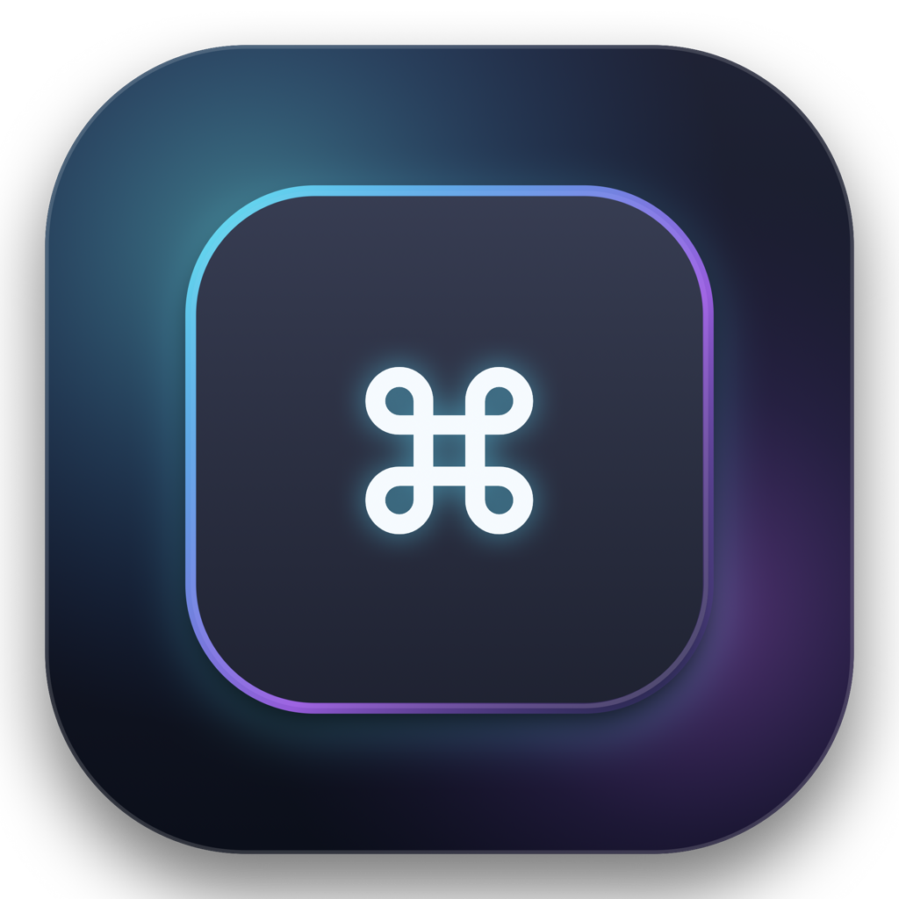

# KeyGlow (KeyGrow) ⌨️✨

<p align="center">
  
</p>

<p align="center">
  <strong>一款轻量、极简、动画优雅丝滑的 macOS 原生键盘操作可视化工具</strong>
</p>

<p align="center">
  <a href="https://github.com/shuifa/KeyGrow/releases/latest"></a>
  <a href="https://github.com/shuifa/KeyGrow/actions"></a>
  
  
  
</p>

---

## 📖 项目简介

**KeyGlow** 专为**屏幕录制、编程教学、设计演示、技术分享与直播**量身打造。参考了 Keystroke Pro 的核心体验与拟物灵感，融合现代化 macOS 设计语言，首要追求：**视觉极度精致、动画丝滑自然、系统性能零负担、核心功能简单克制**。

---

## ✨ 核心亮点

### 1. 拟物键帽视觉（Skeuomorphic Keycap）
- **物理质感：** 每一个按键渲染为微倒角圆角物理键帽，包含渐变高光边框（Highlight Border）、接触阴影与柔和弥散环境光晕（Drop Shadow）。
- **原生 SF Symbols 图标：** 修饰键统一采用 macOS 原生矢量图标（`command`, `option`, `control`, `shift`），严格遵循官方 `⌃ ⌥ ⇧ ⌘` 排序规范。
- **3 款预设视觉质感风格：**
  - **经典深黑（Classic Dark）：** 沉稳石墨暗黑，微浮雕立体光影。
  - **磨砂亚克力（Frosted Glass）：** 超薄毛玻璃（`.ultraThinMaterial`），轻盈通透现代。
  - **极光微光（Aurora Glow）：** 赛博黑曜石底板搭配青紫极光边缘霓虹光晕。

### 2. 特殊键/修饰键独立配色（参考 Keystroke Pro）
- 支持将修饰键与特殊功能键（Esc、Tab、Return、Space、Delete、方向键、F1~F12 等）独立着色：
  - 🔷 **科技冰蓝（Electric Blue）**
  - 🟣 **极光熏紫（Royal Purple）**
  - 🟠 **日落暖橙（Sunset Orange）**
  - 🟢 **霓虹翡翠（Emerald Green）**
  - 🌸 **摩登浆果（Hot Pink）**
  - ⚪ **素雅纯白（Monochrome）**
- 键帽微边框、核心文字与环境光晕呈现双重色彩层次。

### 3. 「右边进、左边出」流式动效（Spring Physics）
- **流式队列：** 连续按键在屏幕上**最多保留 3 个**。
- **右进左出：** 新按键自右侧带物理弹性初速度滑入，最左侧最早按下的按键超时或挤出时平滑向左滑出并淡隐，中间按键丝滑位移。
- **触感反馈：** 连续按下同一按键时触发物理微脉冲震颤（Tap Punch/Pulse），界面无多余数字干扰，节奏感明晰。

### 4. 自由锚点与上下距离微调
- **5 种屏幕定位锚点：**
  - 屏幕底部居中（默认）
  - 屏幕左下角（左对齐自然展开）
  - 屏幕右下角（右对齐自然展开）
  - 屏幕顶部居中
  - 跟随鼠标光标
- **上下距离自由调节：** 支持滑动条调节距屏幕边缘的像素高度（20pt ~ 220pt），避开各类 Dock 栏与状态栏。

### 5. 穿透悬浮窗与极速架构
- **零干扰穿透：** 基于定制 `NSPanel`，配置 `ignoresMouseEvents = true`，鼠标点击与手势 100% 穿透到底层窗口，绝不阻碍用户操作。
- **多桌面与全屏穿透：** `collectionBehavior = [.canJoinAllSpaces, .fullScreenAuxiliary, .stationary]`，虚拟桌面 Spaces 切换及全屏应用时始终悬浮常驻，不抢夺输入焦点。
- **后台纯监听：** 基于 `CGEventTap`（`.listenOnly`）运行于专用后台线程，对日常打字零延迟；内置超时自愈机制；遇密码输入框（Secure Input）自动静默降级保护隐私。

---

## 📦 快速下载与安装

直接前往 **[GitHub Releases](https://github.com/shuifa/KeyGrow/releases)** 下载最新版本的 `.dmg` 安装包：

1. 下载 `KeyGlow-v0.4.dmg`。
2. 双击打开并将 **KeyGlow.app** 拖入 **Applications（应用程序）** 目录。
3. 启动应用并按提示授予辅助功能权限即可开始使用。

---

## 🛠️ 技术架构

- **UI & 动效：** 纯原生 SwiftUI 5，结合 `phaseAnimator`、Spring 弹簧物理曲线。
- **窗口管理：** AppKit `NSPanel` + `NSHostingController`（解耦布局约束，杜绝 Auto Layout 递归）。
- **底层监听：** CoreGraphics `CGEventTap` + Carbon 键码映射 + Unicode 字符提取。
- **常驻入口：** 状态栏菜单（`NSStatusItem`）常驻管理，支持一键切换监听、过滤模式、视觉风格与偏好设置。

---

## 🚀 编译与运行

### 系统要求
- macOS 14.0 (Sonoma) 或更高版本
- Xcode 15.0+ / Swift 5.9+

### 构建步骤
```bash
# 克隆仓库
git clone git@github.com:shuifa/KeyGrow.git
cd KeyGrow

# 打开 Xcode 工程
open KeyGlow.xcodeproj
```
或者直接使用命令行构建：
```bash
xcodebuild -project KeyGlow.xcodeproj -scheme KeyGlow -destination 'platform=macOS' build
```

---

## 🔐 辅助功能权限说明

由于需要全局捕获快捷键，KeyGlow 首次运行时需要授予 **辅助功能权限（Accessibility）**：
1. 启动 KeyGlow，若尚未授权将自动弹出偏好设置。
2. 点击 **「去授权」** 按钮，系统将自动打开 **「系统设置 -> 隐私与安全性 -> 辅助功能」**。
3. 勾选 **KeyGlow** 即可立即开始使用。

---

## 📄 开源许可证

本项目基于 [MIT License](LICENSE) 协议开源。
